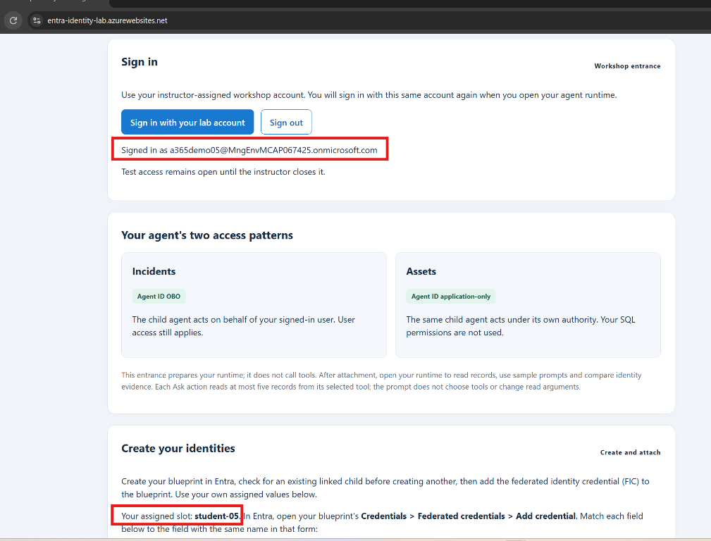
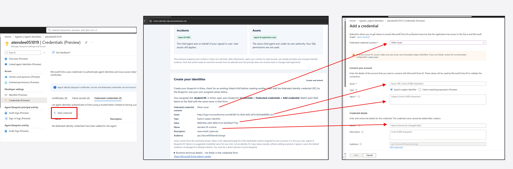
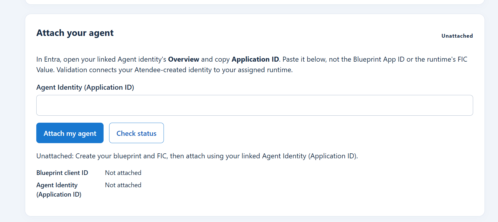
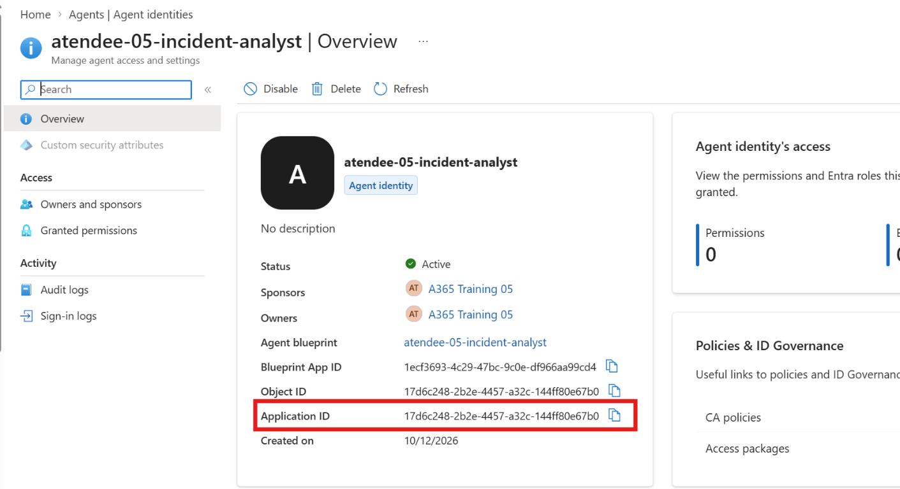

# Lab 02 - Atendee guide

## What you will build

Create a Microsoft Entra agent identity blueprint and a federated identity
credential (FIC). Use the agent identity linked to your blueprint, attach it to
your assigned website, then ask the agent to summarize security incidents,
observing the agent acting on behalf of your signed-in user. After you request
the Assets access package and the instructor approves it, the agent accesses
Assets using its own identity, rather than acting on behalf of your user.

## 1. Sign in to the Lab 02 entrance

1. Open https://entra-identity-lab.azurewebsites.net/.
2. Select **Sign in with your lab account**.
3. Use your assigned workshop account, not your personal or work account.
4. Confirm your assigned Atendee slot appears.

## 2. Create your blueprint

The instructor assigns Agent ID Administrator for this dedicated lab's portal
creation workflow. It is a tenant-wide role, not limited to your slot: change
only your own lab objects. The instructor removes lab roles during cleanup.

1. Open [Microsoft Entra admin center](https://entra.microsoft.com/).
2. Select the workshop tenant.
3. Go to **Entra ID > Agents > Agent blueprints**.
4. Create a blueprint named with your assigned Atendee slot, for example
   `atendee-17-incident-analyst`.
5. Select your workshop account as a sponsor.
6. Record the blueprint's application/client ID.
7. Open the blueprint's **Linked agent identities**. Select the existing agent
   identity, confirm its parent is your blueprint, and record its
   **Application ID**. The entrance calls this **Agent Identity (Application ID)**.
   Do not create a duplicate.

## 3. Add federation to the blueprint

On your **blueprint**, open **Credentials > Federated credentials** and select
**Add credential**.

Keep your Lab 02 entrance open beside the Entra form. The entrance shows your
assigned values under the **same field names** as the form. The Issuer comes from
the workshop tenant; Value comes from your dedicated runtime managed identity.
These are supplied by the lab, not numbers you create or obtain from the blueprint.

Use the manual-entry scenario for this lab:

1. Under **Federated credential scenario**, select **Other issuer**.
2. Copy **Issuer** from the entrance into **Issuer** in Entra. The full URL ends
   in `/v2.0`; do not enter the lab website URL.
3. Keep **Explicit subject identifier** selected. In **Value** (placeholder:
   **Subject**), paste **Value** from the Lab 02 entrance. This is the runtime
   managed identity's **object/principal
   ID**, not its client ID, your user ID, or either Agent/blueprint ID. Each
   Atendee has a different value; use only the one displayed for your slot.
4. Copy **Name** from the entrance into **Name** in Entra. This is a suggested
   credential name, such as `atendee-17-runtime`, not an identity ID. Do not add
   a trailing period or spaces.
5. Leave **Description** blank; it is optional.
6. Confirm **Audience** matches the entrance's **Audience**:
   `api://AzureADTokenExchange`. Leave the default unchanged if it already matches.
7. Review the issuer, value and audience against your entrance values, select
   **Add**, and confirm the credential appears in the blueprint's list.

This trust allows only your assigned runtime identity to authenticate through
your blueprint. A FIC does not contain a password.

## 4. Attach your agent

1. Return to the workshop entrance.
2. Paste your **Agent Identity (Application ID)** from the linked Agent identity's
   **Overview > Application ID** field.
3. Select **Attach my agent** once.
4. Watch the progress indicator and status:
   **Queued > Validating > Granting > Binding > Checking > Ready**.

### Where to find Agent Identity (Application ID)

Open **Entra ID > Agents > Agent identities**, select your linked identity, and
copy **Application ID** from its **Overview**.

## 5. Request Assets access for your Agent Identity

This exercise uses the existing **Identity Lab — Agent Assets Read** access
package. Request it for your **Agent Identity**, not for your workshop user,
blueprint or runtime managed identity.

1. Open [My Access](https://myaccess.microsoft.com/) and sign in with your
   workshop account, not the instructor's approval account.
2. Select **Access packages**, **View All**, locate **Identity Lab — Agent Assets Read**,
   and select **Request**.
3. Under **Request details**, select **Requesting for Sponsored agent**.
   If you are its owner rather than its sponsor, select **Requesting for Owned
   agent**. Select your linked Agent Identity and select **Continue**.
   Provide a **Business Justification** and click **Submit request**.
4. Wait for instructor approval and successful access provisioning. An approval
   notification alone does not prove the agent's permission has propagated.
   No administrator needs to enable the runtime after approval. The existing
   package requires justification and one instructor approval
   stage; its assignments expire after one day.
5. Retry **Read assets - as the agent, no model** with the same agent. The
   expected result is a bounded Assets read.

Reference: [Request an access package on behalf of an agent identity](https://learn.microsoft.com/en-us/entra/id-governance/entitlement-management-request-behalf#request-an-access-package-on-behalf-of-an-agent-identity).

## 6. Prompt your agent

1. When status is **Ready**, select **Proceed to my agent** in the validation-complete panel.
2. Sign in with the same workshop account. This sign-in requests access to your
   blueprint's scope, separately from entrance authentication.
3. Select **Read incidents - no model** first.
4. Enter:

   > Summarize the active incidents, citing each incident ID, severity and status.
   > Explain what the supplied data does not tell you.

5. Select **Ask about incidents - Foundry summary**.
6. Wait for the loading indicator to finish.

The runtime reads at most five incident summaries. It does not query Assets or
let the model choose additional tools. A Ready attachment proves configuration
and permission readback, not a successful data read; your first successful read
and answer are the end-to-end verification.

After the Assets assignment in Step 5 is provisioned and its read succeeds,
enter **Summarize the returned assets, citing their identifiers and owners when
present. Do not invent missing information.** and select **Ask about assets -
Foundry summary**. Each Assets request checks the approved entity metadata and
reads at most five assets. Its MCP token represents your Agent Identity alone,
with no represented user. Combined Run remains disabled.

## 7. Inspect identity evidence

At the bottom of your runtime, find **Identity evidence**:

- **Acting on behalf of you:** Incidents runtime evidence shows your child agent
  and your represented user. Its downstream Entra resource is Microsoft Graph.
- **Acting as the agent:** Assets runtime evidence shows the same child, with no
  represented user. Its Entra resource is the Assets API.

Record the result's request ID and UTC completion time. Compare:

- Agent Identity (Application ID): your linked agent identity.
- Represented user: your workshop user.
- Permission mode: delegated Agent ID OBO.
- Incident IDs, status and severity in the answer versus the returned data.
