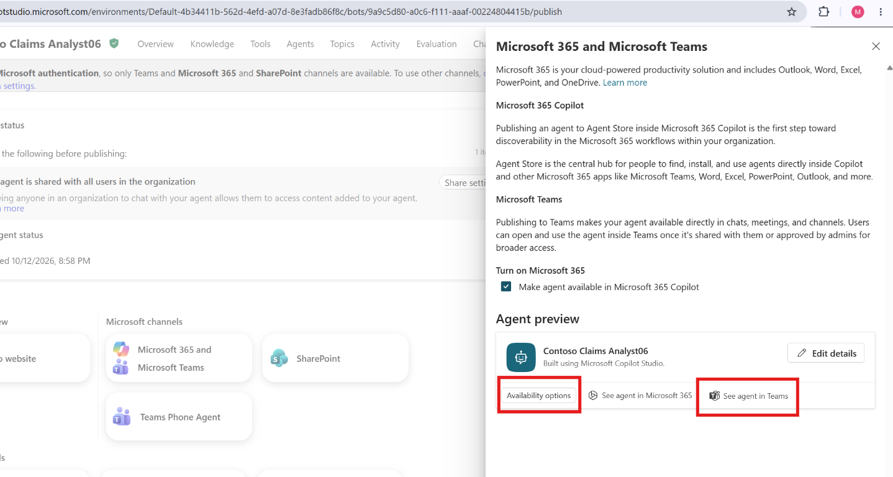
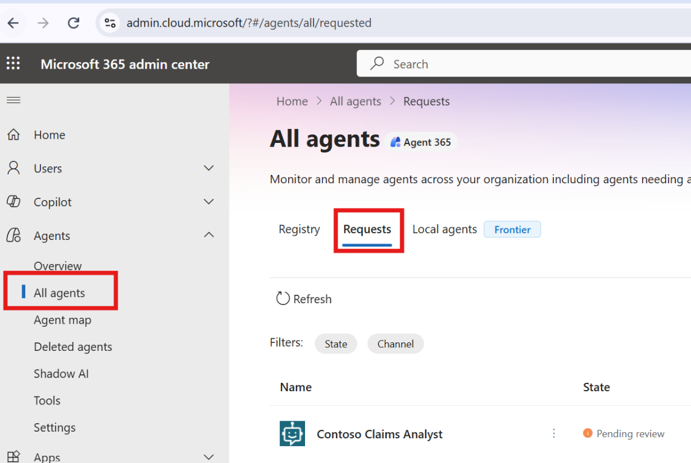
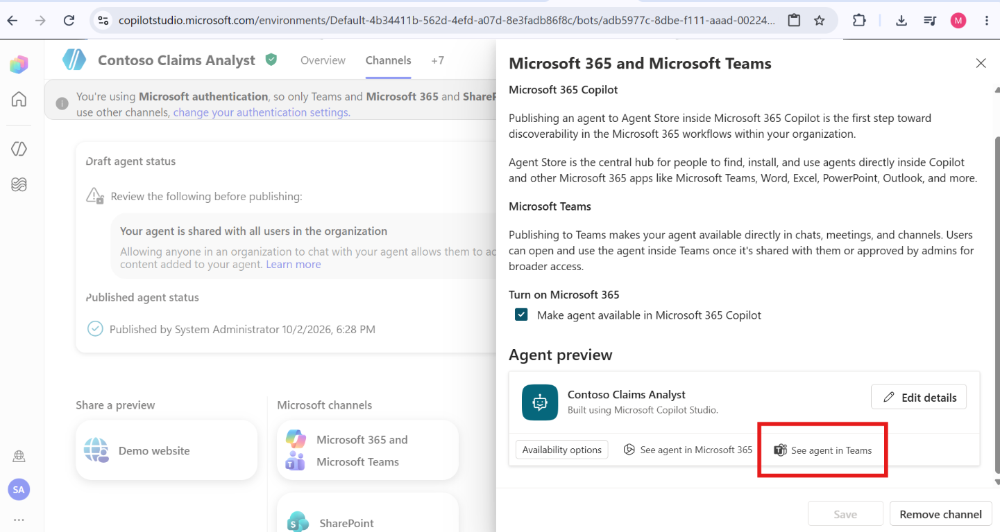
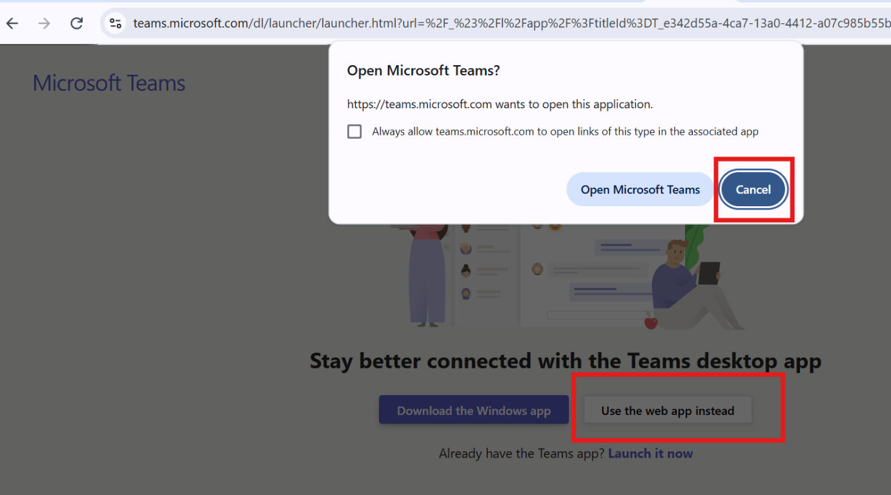

# Lab 01 - Copilot Studio Agents

## Before starting

- Use the temporary workshop account, not your personal work account. It needs
  SharePoint read access to the Claims site and its documents.

## Step 1: Create the Claims Analyst agent

1. Go to https://copilotstudio.microsoft.com/environments/Default-4b34411b-562d-4efd-a07d-8e3fadb86f8c/home
   and sign in with the temporary credentials.
2. Left nav → the Agents icon. You land on the Agents list.
3. Top-right → click the chevron (⌄) next to New agent to open the build options.
4. Under Other ways to build, choose Agent Standard ("Create a rule-based
   conversational agent with predefined topics and flows").
5. On the "Describe your agent" screen, choose Skip to configure (top-right) for a
   predictable path.
6. On the configure form, set:
   - Name: `Contoso Claims Analyst`
   - Description: `Helps claims analysts find and summarize insurance claim files.`
   - Instructions: `You are a claims assistant for Contoso Insurance. Answer only from the
     connected Claims document library. Be concise and cite the claim number.`
7. In the Knowledge section of the agent, select Add knowledge → SharePoint.
8. Paste the Claims library URL:
   `https://mngenvmcap067425.sharepoint.com/Shared%20Documents/Forms/AllItems.aspx`
9. Add → Add to agent. Wait until the source shows Ready (indexing can take a few
   minutes).
10. Test pane: ask *"List any claims flagged for SIU"* and confirm it answers from the
    library (proves OBO + SharePoint trimming works for a user who has access).
11. Publish the agent (top-right).
12. Open the Channels tab (top nav).
13. Under Microsoft channels, select Microsoft 365 and Microsoft Teams. If prompted, select
    Add channel (you'll see "The channel was added").
14. In the channel panel, select Availability options.
15. Under Show in the store, choose Show to everyone in my org (appears in "Built by your org"
    after admin approval).

---

## Step 2: Confirm the Agent Identity and block a risky agent with Conditional Access

1. Go to https://entra.microsoft.com → Agents → Agent identities.
2. Open Contoso Claims Analyst.
3. Create the Conditional Access policy that blocks a high-risk agent:
   - Entra admin center → Protection → Conditional Access → Policies → New policy. Name it
     Block High-Risk Agent.
   - Assignments → Users, agents, or workload identities → Agents → Select agent identities →
     pick Contoso Claims Analyst.
   - Target resources → All resources.
   - Conditions → Agent risk → High.
   - Grant → Block access (agents can't satisfy MFA, so the grant must be Block).
   - Enable policy → On. Save.
4. Publish the agent to the store from the Microsoft 365 admin center:
   - Open the [Microsoft 365 admin center](https://admin.cloud.microsoft/?#/agents/overview)
     with an administrator account. Go to Agents → All agents, then select the Requests tab.

     

   - Find your Contoso Claims Analyst agent, open it, and click Publish to the store.
   - Keep All users selected for this lab, then click Next → Next → Publish.
5. Open the agent in Teams and prompt it (this exercises the agent identity, not the Test pane):
   - Go back to Copilot Studio and open the Contoso Claims Analyst agent.
   - Open the Channels tab and select the Microsoft 365 and Microsoft Teams channel.
   - In the channel panel, under Agent preview, click See agent in Teams.

     

   - A browser dialog asks to open Microsoft Teams. Click Cancel, then choose
     Use the web app instead to run Teams in the browser.

     

   - When the agent opens in Teams, send a prompt to make it fetch claims data. Sample prompts:
     - `Which claims are flagged for SIU?`
     - `Summarize the examiner notes for claim CL-2026-010171.`

> [!CAUTION]
> **🛑 ATTENDEES, FULL STOP.** Your Microsoft
> instructor will flag the lab agents in **Risky agents** as **Confirmed compromised** (High
> risk) so the **Block High-Risk Agent** policy takes effect. Wait for the instructor's go-ahead
> before continuing.

---

> [!NOTE]
> All data used in this lab is **fictitious**. The claims, policies, people, salaries, and HR
> records are generated for training only and do not represent real individuals or events. Any
> resemblance to real entities is coincidental.
